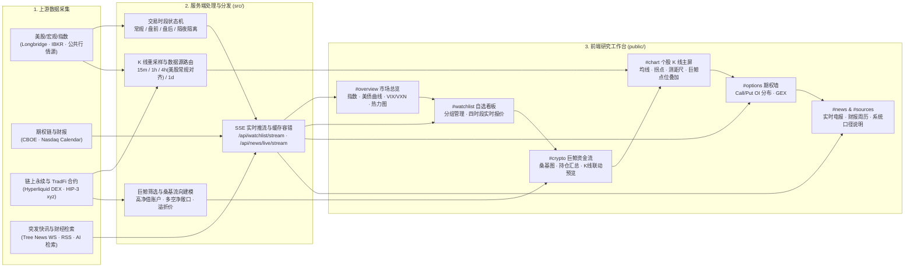

# Market Desk

**Market Desk** 是一套面向美股研究、宏观监控与链上衍生品资金跟踪的轻量级本地金融研究工作台（支持桌面端与移动端浏览器访问）。系统采用原生 **Node.js ESM + 免打包 Vue 3** 架构，冷启动即用，将多时段股票行情、宏观利率与波动率、期权 Gamma 持仓、Hyperliquid / HIP-3 链上巨鲸动向、突发快讯与财报日历串联成一套完整的研究决策闭环。

---

## 1. 系统整体工作流

Market Desk 的核心不是孤立页面堆砌，而是围绕「**宏观定调 -> 标的筛选 -> 资金与仓位穿透 -> K 线时空验证 -> 事件催化跟踪**」构建的全链路工作流：



### 日常研究操作闭环

1. **市场环境定调（`#overview` / `#flows`）**
   - 启动后先查看核心美股指数（`SPY` / `QQQ` / `DIA` / `IWM`）、美元离岸人民币与现货黄金报价，结合 **2Y/10Y/20Y/30Y 美债收益率曲线**、**VIX vs VXN 波动率对照**及 **CNN 市场情绪指标**，判断当日风险偏好与板块资金轮动方向（`#flows`）。
   - 通过 **美股核心权重板块热力图** 锁定常规交易时段内放量领涨或领跌的标的。
2. **多时段自选盯盘（`#watchlist` & 右侧折叠自选栏）**
   - 支持手动维护或接入 Notion 自选库，配合服务端 **SSE 长连接（`/api/watchlist/stream`）** 接收 **Longbridge** 或 **IBKR Gateway** 的常规/盘前/盘后/隔夜分时段报价（未配置券商时自动回落至公共行情源）。
   - 在任何页面都可通过顶栏「自选」按钮展开右侧自选速览面板，点击标的直接切入个股分析。
3. **链上主力与 TradFi 资金流追踪（`#crypto`）**
   - 在 **加密货币主流永续** 与 **HIP-3（`xyz`）链上美股合约** 两个赛道间切换，通过 **多空资金流向桑基图** 快速识别高净值巨鲸钱包集中做多或做空的标的，支持自定义添加追踪地址与动态榜单范围调整。
   - 在右侧标的持仓汇总表中点击任意标的，行内展开微型 K 线并映射巨鲸开仓点位与相对正股溢折价，确认后点击「大屏分析」一键跳转至个股主图。
4. **K 线时空验证（`#chart`）**
   - 自动切换或手动选择 `15分` / `1小时` / `4小时` / `日K` 周期与 `1日` ~ `1年` 时间范围；向下浏览图表与下方信息时，全局顶栏随滚动向上收起，K 线标的与周期/范围控制栏自动停靠顶部，保证高频切换零遮挡。
   - 可按需叠加 `MA5~MA250` 均线、**DEMA 拐点标注（`EB/B/ES/S`）**、**交互测距尺（`Shift` + 拖拽）**、**Hyperliquid 24/7 链上连续合约 K 线切换**，以及开启 **巨鲸点位叠加侧栏**——直接在真实蜡烛价格位置查看多空加权成本、单一席位开仓点、预估强平价与开仓时间虚线。
5. **期权结构、新闻催化与统一口径核查（`#options` / `#news` / `#sources`）**
   - 在 `#options` 对照 CBOE 期权链的 Call Wall、Put Wall、Put/Call Ratio 与总 Gamma 敞口（GEX），验证技术位与期权压制位是否重合。
   - 在 `#news` 接收 Tree News 毫秒级实时电报、执行多源财经检索或打开 Nasdaq 财报周历；所有界面口径规则、数据源限制与指标计算方法统一收录于左侧导航底部 `#sources`（「说明」）。

---

## 2. 技术栈与项目结构

### 核心技术选型

- **服务端**：原生 **Node.js ESM**（内置 `http` / `fs/promises` / `node --test`），无额外 Web 框架依赖，提供静态资源托管、API 聚合与多路 SSE 推流。
- **前端视图**：**Vue 3**（ESM 零构建运行）、**Lightweight Charts**（K 线画布及原生 Canvas 图层原语）、**Apache ECharts**（收益率曲线及衍生图表）与自研 SVG 桑基图/期权分布图。
- **实时与数据源适配器**：Longbridge OpenAPI、IBKR TWS/Gateway、Hyperliquid Info REST & HIP-3、CBOE、Nasdaq、Tree News WebSocket、Tavily / Firecrawl / Exa / RSS。

### 目录说明

```text
Market-Desk/
├── src/                                  # Node.js ESM 服务端与数据聚合引擎
│   ├── server.js                         # HTTP 服务入口、静态资源与 API/SSE 路由分发
│   ├── env.js                            # .env 环境变量加载
│   ├── market-workspace.js               # 总览、K 线（含 4H 重采样与 HIP-3 路由）、新闻、期权协调器
│   ├── workspace-data.js                 # 核心指数、宏观与基准数据定义
│   ├── market-data.js                    # K 线历史拉取与美股常规时段 4H 重采样
│   ├── market-sessions.js                # 美东交易时段、夏令时与节假日状态机
│   ├── watchlist-quotes.js               # 自选报价缓存、数据源切换与 SSE 广播
│   ├── quote-providers/                  # 实盘券商行情适配器
│   │   ├── longbridge.js                 # Longbridge OpenAPI 适配器（支持夜盘）
│   │   └── ibkr.js                       # IBKR Gateway 适配器
│   ├── crypto-whale-service.js           # Hyperliquid & HIP-3 高净值巨鲸发现与持仓解析
│   ├── onchain-stocks-service.js         # 链上美股合约成交统计与正股溢折价核算
│   ├── options-wall.js                   # CBOE 期权链解析、OI 墙与 GEX 计算
│   ├── tree-news-service.js              # Tree News WebSocket 接入与 200 条环形队列 SSE 推流
│   ├── ai-search-service.js              # 多源财经搜索调度与并发去重
│   ├── news-search-policy.js             # 搜索时间窗口与相关性过滤规则
│   ├── news-source-utils.js              # 域名信源分级与 RSS 解析工具
│   ├── earnings-calendar-service.js      # Nasdaq 财报周历获取与双级缓存
│   ├── notion.js                         # 可选 Notion 自选库读取
│   ├── indicators.js / pivots.js         # 技术指标、枢轴点与信号计算
│   └── inflection-hunter/index.js        # 拐点计算核心导出
│
├── public/                               # 浏览器端零构建前端应用
│   ├── index.html                        # SPA 视图骨架与多模块模板
│   ├── app.js                            # 全局状态管理、路由调度、图表与交互控制器
│   ├── styles.css                        # 桌面端主样式、停靠布局与图表叠加层样式
│   ├── mobile-layout.css                 # 移动端（<768px）响应式布局样式
│   ├── color-palettes.css                # 界面主题色板 Token
│   ├── theme-bootstrap.js / theme-model.js # 昼夜主题初始化与配色偏好管理
│   ├── watchlist-model.js                # 自选股分组、排序与时段价差模型
│   ├── flows.js                          # 资金流与市场轮动数据模型
│   ├── earnings-calendar-model.js        # 财报日历前端格式化模型
│   ├── inflection-signals.js             # DEMA14/30 拐点评分与图元转换
│   ├── mobile-workspace.js / mobile-quote-view.js # 移动端导航与报价视图模型
│   ├── composables/                      # 独立图形、动量与数学模型模块
│   │   ├── whaleSankeyModel.js           # 巨鲸桑基图节点裁剪、流向拓扑与脉冲差分检测
│   │   ├── whaleMarkerCanvasPrimitive.js # K 线 Canvas 原生巨鲸点位绘制原语
│   │   ├── klineGesture.js               # K 线主图拖拽/缩放/价格轴手势分发器
│   │   ├── klinePriceMotion.js           # Y 轴价格缩放阻尼与防闪烁锁定
│   │   ├── klineViewportMotion.js        # X 轴视口惯性平滑求解器
│   │   ├── klineWheelInput.js            # 鼠标滚轮与触控板手势识别
│   │   ├── klineGeometry.js              # K 线屏占比、视口拟合与锚点几何计算
│   │   └── chartDerivedData.js           # MA / DEMA 与十字光标读数缓存
│   └── inflection-hunter/                # 浏览器端拐点算法分片模块
│
├── test/                                 # 自动化单元测试与 JSDOM 端到端测试套件
├── .env.example                          # 环境变量示例模板
└── package.json                          # 运行、静态语法检查与测试脚本
```

---

## 3. 快速安装与启动

### 环境要求
- **Node.js** `>= 22.0.0`（使用原生 ES Modules 及内置 `node --test`）
- **操作系统**：macOS / Linux / Windows

### 启动步骤

```bash
# 1. 克隆仓库并安装依赖
git clone https://github.com/z7c2046/Market-Desk.git
cd Market-Desk
npm install

# 2. （可选）创建环境变量文件以接入实盘券商、AI 检索或 Notion 自选
cp .env.example .env

# 3. 启动服务（默认监听 http://127.0.0.1:5174）
npm start

# 或使用开发热监听模式
npm run dev
```

启动后在浏览器访问 `http://localhost:5174` 即可开始使用。

---

## 4. API 与实时推流端点

| 方法 | 路径与参数 | 说明 |
| :--- | :--- | :--- |
| `GET` | `/api/health` | 健康检查与版本信息 |
| `GET` | `/api/market/overview` | 大盘指数、宏观基准、美债曲线、VIX/VXN 与板块热力图 |
| `GET` | `/api/market/chart?symbol=SPY&range=3mo&interval=1d&venue=auto` | K 线数据（支持 `venue=hyperliquid` 切换 HIP-3 24/7 合约并保留回落机制） |
| `GET` | `/api/macro` | 宏观外汇与大宗商品即时指标 |
| `GET` | `/api/crypto` | 加密资产实时行情列表 |
| `GET` | `/api/crypto/whales?category=stocks&topN=12&custom=0x...&force=1` | 链上巨鲸与 TradFi 持仓、净敞口及资金流数据 |
| `GET` | `/api/crypto/onchain-stocks?force=1` | 链上美股成交榜单与正股溢折价计算 |
| `GET` | `/api/options?symbol=NVDA` | CBOE 期权链 OI 分布与总 Gamma 敞口 |
| `GET` | `/api/watchlist?force=1` | 读取自选标的列表 |
| `GET` | `/api/watchlist/quotes?symbols=NVDA,TSLA` | 批量查询多时段实时报价 |
| `GET` | `/api/watchlist/stream?symbols=NVDA,TSLA` | **SSE**：实时推送自选标的报价更新 |
| `GET` | `/api/ibkr/status` · `/api/ibkr/reconnect` | 查询 IBKR Gateway 连接状态或触发重连 |
| `GET` | `/api/earnings/calendar?weekStart=2026-11-02&force=1` | Nasdaq 财报周历（按美东周一分组） |
| `GET` | `/api/news?symbol=NVDA` | 市场与个股资讯列表 |
| `GET` | `/api/news/ai-search?query=...` | 多源财经检索聚合（Tavily / Firecrawl / Exa + RSS） |
| `GET` | `/api/news/live/stream` | **SSE**：Tree News 实时快讯广播 |
| `GET` | `/api/news/live/history` · `/api/news/live/status` | 获取近期缓存快讯与上游连接状态 |

---

## 5. 可选环境变量配置（`.env`）

零配置即可依靠公共数据源与链上数据源完整运行；如需启用实盘行情、AI 检索或自选同步，可按需配置以下变量：

| 分类 | 变量名 | 说明 |
| :--- | :--- | :--- |
| **服务端口** | `PORT` / `HOST` | HTTP 监听端口与主机地址（默认 `5174` / `127.0.0.1`） |
| **券商优先级** | `QUOTE_PROVIDER` | 指定自选实时报价主通道（`longbridge` 或 `ibkr`） |
| **长桥 OpenAPI** | `LONGBRIDGE_APP_KEY` / `LONGBRIDGE_APP_SECRET` / `LONGBRIDGE_ACCESS_TOKEN` | 接入长桥实盘报价（支持 `LONGBRIDGE_ENABLE_OVERNIGHT=false` 关闭夜盘） |
| **IBKR Gateway** | `IB_GATEWAY_HOST` / `IB_GATEWAY_PORT` / `IB_CLIENT_ID` | 连接本地或内网 IBKR TWS / Gateway（含 `IB_CONNECT_TIMEOUT` / `IB_AUTO_RECONNECT`） |
| **AI 财经检索** | `TAVILY_API_KEY` / `FIRECRAWL_API_KEY` / `EXA_API_KEY` | 启用对应搜索引擎（未配置时默认保留 RSS 检索） |
| **突发快讯源** | `TREE_NEWS_WS_URL` / `TREE_NEWS_REST_URL` / `TREE_NEWS_API_KEY` | 自定义 Tree News 连接端点与密钥 |
| **Notion 自选** | `NOTION_TOKEN` / `NOTION_DATABASE_ID` | 从已有 Notion 数据库同步自选股列表 |

---

## 6. 快捷交互与工程验证

### 常用交互
- `⌘K` / `/`：任意页面快速聚焦股票搜索框（处于 `#chart` 滚动状态时自动回顶聚焦）
- **K 线画布**：左键拖拽平移历史、滚轮缩放 K 线密度、右侧价格轴拖拽/滚轮独立调节纵轴、`Shift` + 拖拽拉出测距尺、双击时间轴或点击 `⟲ 复位` 恢复视角
- **巨鲸点位叠加**：点击图表买/卖点或右侧席位卡片可锁定单鲸视角并拉出开仓时间参考线；点击空白处或按 `Esc` 解除锁定并关闭详单浮窗

### 静态检查与自动化测试

```bash
# 对 src/ 与 public/ 共 40 个核心 JS 文件执行语法检查
npm run check

# 运行全量单元测试与 JSDOM 端到端测试（当前 273 项测试）
npm test

# 按专题运行局部测试
npm run test:workspace
npm run test:news
```

---

## 7. 许可声明

第三方组件与开源许可说明请参阅 [licenses/gflows-MIT.txt](licenses/gflows-MIT.txt)。
