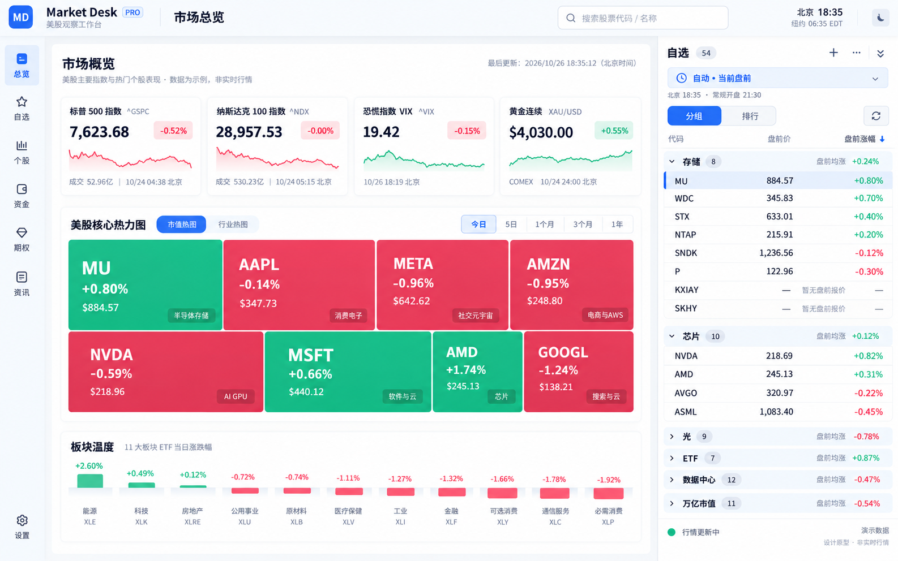

**Market Desk 全站前端改造代码指令书 · 已确认原型版**

版本：2026-10-26 / v1。适用目录：`D:\YUXIANZHAO\Code\Market Desk`。

本文件是可交给 Codex、Gemini、AntiGravity 或开发者执行的实现规格。本次交付仅保存原型、梳理代码并编写指令，没有实施应用改造。文中“新增、调整、必须通过”均为后续开发要求，不表示已经完成。

设计依据：[用户确认的原型 PNG](design/market-desk-approved-prototype-light-v1.png)。

代码依据：[当前工作区基线与 SHA-256 清单](design/market-desk-redesign-baseline-2026-10-26.json)。基线包含已有未提交修改，不能用 Git HEAD 覆盖当前文件。



**01. 最重要的执行规则与优先级**

整体目标：把现有 Market Desk 迁移到原型的浅色、蓝色强调、窄左导航、中央研究区、独立右侧自选的设计。全部现有业务页面仍然可用。

冲突时按以下顺序判断：

1. 用户本轮明确要求保留的模块、数据内容和交互。
2. 本指令书的保护范围、数据口径与验收条件。
3. 已确认原型中的配色、空间关系和自选面板。
4. 旧的审查文档、早期设计建议及通用设计技能。

原型中画出的简化热力图不属于替换目标。原型中只有四张宏观卡片，也不意味着最终只保留四项指标。原型里的数值、组数量、时间、折线形状和标签是示意，必须绑定真实数据与用户已有状态，不能硬编码。

不要另起一个 React、Next.js 或 Vue SFC 项目，不更换技术栈，不顺便升级图表库。当前是 Node 服务端 + Vue 3 全局运行时 + 浏览器 ES Modules + ECharts + Lightweight Charts。

**02. 保留与重做矩阵：实施时逐项核对**

| 模块 | 原样保留 | 按原型改造 | 禁止的结果 |
|---|---|---|---|
| 美股核心热力图 | 完整模块设计、红绿颜色、树图布局逻辑、股票标签、分组筛选、热力池、权重切换、提示与点击详情 | 移入新中央工作区，响应可用宽度；外部页面间距调整 | 用原型里少量等尺寸彩块替换；删筛选和权重；随自选盘前模式擅改其数据口径 |
| 个股 K 线 | 图表设计、所有配色方案、画布背景、网格、MA/成交量、读数栏、拖动缩放、坐标轴交互、切标的复位 | 页面外壳、周边留白、与右侧自选的联动布局 | 换图表引擎、换手势、把 K 线改成静态图、强制放大到固定少量 K 线 |
| 新闻快讯 | 卡片瀑布流，所有列等宽、卡片随内容自然不同高；现有筛选/收藏/跳转 | 卡片与筛选栏的配色、边框、圆角、字体层级，接入新页面外壳 | 等高卡片网格、列表表格、横向轮播、精选卡跨列破坏等宽 |
| 宏观与指数 | 全部已有指标、数据通道、必要说明、已有详情入口 | 新卡片外观、顺序与响应式排列 | 照原型仅留下四张卡片，或用静态示例数值填满 |
| 美债 | 10Y/20Y/30Y 数据内容和展开交互 | 首页只展示 10Y 数值；点击展开后展示三期限 | 首页同时摆三个收益率数值；删掉 20Y/30Y；把估算说成实时报价 |
| 加密货币 | BTC 总览入口，独立加密页及现有六个币种、周期/图表/行情功能 | 卡片、控件、详情布局采用新设计 | 把加密页删掉；把美股盘前过滤套到 24/7 加密行情 |
| 自选 | 用户股票、分组 ID、组名、成员、多组关系、折叠、排序、拖拽、导入导出 | 独立右侧面板，当前时段主报价，简洁列头与操作区 | 清空本地数据、恢复默认示例分组、同时显示两份独立自选 |
| 板块温度 | 11 个 ETF、涨跌排名、计数与资金观察入口 | 从热力图右侧迁到下方横向模块 | 与新自选抢占右侧；把板块涨跌当作实际资金流入 |
| 资金、期权、数据说明、设置 | 现有路由与功能、请求与计算口径 | 页面结构、控件、表格、弹窗采用新外观 | 因原型没有画出来而删除业务能力 |

这里的“原样保留”是代码复用和行为保护，不是重新写一个看起来类似的替代品。“保留数据”是保留字段、用途和来源，不是保留错误时段、假时间戳或没有标识的估算数据。

**03. 当前代码地图与已存在的修改**

行号用于定位本次基线；开发前以函数名、选择器和绑定搜索，不能只依赖行号。

| 文件 / 锚点 | 当前职责 | 改造方式 |
|---|---|---|
| `public/index.html`，`#app`、`.sidebar`、`<main>`、顶部工具区 | 全站模板与外壳 | 重构外层区域；保留内部业务事件绑定 |
| `public/app.js`，`nav`、`navigate`、`selectSymbol`、`refresh` | 路由、选中标的、刷新入口 | 接入新外壳；保持原页面 ID 和 hash 链接 |
| `public/index.html:578`，`.heatmap-panel`、`#heatmap-chart` | 完整热力图模板 | 原模块整体迁入，不替换子结构 |
| `public/app.js`，`activeHeatmapStocks`、`stockSectors`、`renderHeatmap`（约 2726 行） | 热力图范围、过滤、树图配置 | 保护；只允许为外层尺寸变化做生命周期适配 |
| `public/app.js`，`makeChart`、`render` | 多种图表共用绘制与 resize | 谨慎改；禁止为新外壳全局修改导致热力图/K 线外观变化 |
| `public/index.html:804`，`.chart-panel`、`#price-chart` | 个股 K 线与工具 | 保留图表内部结构和控件，只迁移外壳 |
| `public/app.js`，`KLINE_SCHEMES`、`renderPrice`（约 2888 行）、`resetPriceChartZoom`、`disposePriceChart` | 当前实际 K 线运行链 | 受保护，不重写、不换实现 |
| `public/composables/klineGesture.js` | 当前实际指针、滚轮、轴交互 | 原样复用 |
| `public/composables/klineGeometry.js` | 平移、缩放、最新 K 线锚点几何 | 原样复用 |
| `public/composables/useChart.js` | 仓库中另一份旧图表封装 | 当前 `app.js` 没有导入它；不要误用它替换现有图表 |
| `public/index.html:435–575` | 指数、CNN、黄金、美债、DXY、油价、BTC 总览卡片 | 保留数据绑定，重新布局；油价独立成卡 |
| `public/app.js`，`macroItems`、`macroMap`、`goldCnyPerGram`、`cryptoList` | 宏观与加密展示模型 | 复用字段；明确缺失、估算、来源和时间 |
| `public/index.html:2927`，`showTreasuryModal` | 美债详情弹窗 | 保留三期限内容与开关，按新弹窗样式迁移 |
| `public/index.html:1728`，`.news-waterfall-masonry`、`.news-card-waterfall` | 新闻瀑布流 | 保留流式结构，更新样式和容器断点 |
| `public/styles.css:7679` | 新闻 CSS columns 与 `break-inside` | 优先复用，不引入一套新 JS 瀑布流引擎 |
| `public/watchlist-model.js` | 分组存储、迁移、排序、报价选择 | 复用分组管理；补独立的显示投影 |
| `src/watchlist-quotes.js` | 快照、SSE、备用源 | 修正错标/时间/合并，不影响 K 线 bars 结构 |
| `src/market-sessions.js` | 场次与涨幅基准 | 校验与前端一致性；不可只按标签猜报价场次 |
| `src/market-workspace.js`、`src/workspace-data.js` | 宏观、加密、行情、新闻数据 | 保留接口；只做必要的来源状态和数据质量修正 |
| `src/server.js` | API、静态资源、vendor | 继续使用原路由；新增静态 CSS/JS 可以由当前机制服务 |

本次开始时已有 7 个未提交修改文件：`public/app.js`、`public/index.html`、`public/styles.css`、`public/watchlist-model.js`、`src/market-sessions.js`、`src/watchlist-quotes.js`、`src/workspace-data.js`。必须保留并在其上增量修改。

编写期间又检测到 `public/app.js`、`public/index.html`、`test/workspace-ui.test.js` 有其他修改，其中包括成交量与 OHLC 读数颜色跟随当前 K 线配色、测试补充。已读取这些变化，并再次执行同一组 58 项测试和语法检查，均通过；基线 JSON 已更新为复查后的文件摘要。实施前仍需重新读取实时 diff，以保护之后继续产生的工作。

最新工作区已增加本地时段推断、`serverSession`、延迟徽标、个股 EXT 信息、自动模式优先选择当前 EXT 场次，以及盘前基准优先级调整。因此旧文档 `WATCHLIST_UI_REVIEW_2026-10-26.zh-CN.md` 的所有问题不能不经复核地照单认定仍然存在。本文件后面的待修清单按本次最新源码编写。

**04. 总体布局及响应式规格**

桌面采用三部分工作区：左导航、中央内容、右自选。顶部应用栏横跨全宽；中央页面和自选列表各自拥有滚动区域。

| 项目 | 起始实现值 | 说明 |
|---|---|---|
| 顶部栏 | 64px 高 | 品牌、当前页面、全局标的搜索、北京/纽约时钟、主题/设置 |
| 左导航 | 72px 宽 | 图标 + 2～4 字短标签；选中项淡蓝底、蓝色图标 |
| 右自选 | 默认 400px，用户可调 360～480px | 以实际 CSS 像素为准，宽度保存在新 UI 偏好中 |
| 中央页面 padding | 桌面 20～24px，小屏 12～16px | 只作用于外层，不修改受保护图表内部 margin |
| 模块间距 | 16～20px | 禁止每模块一套无规律间距 |
| 自选内部 | 固定标题/时段/列头 + 可滚动列表 + 固定状态栏 | 任意滚动位置都能切换时段和排序 |
| 页面高度 | 以 `100dvh` 形成应用外壳 | Grid/Flex 子项设置 `min-height:0; min-width:0`，防止整页被撑开 |

宽度规则：1440px 及以上默认展示右侧自选；1280～1439px 使用约 360px 的紧凑面板；低于 1280px 默认收为可打开的右侧抽屉，中央研究区得到完整宽度。实际中央宽度不足以正常展示图表时优先收起面板，而非压小文字。用户手动展开/收起偏好与自动响应式状态分开保存。

手机保留可直接访问的自选页，导航通过底部常用入口和“更多”覆盖全部页面。抽屉要有遮罩、Escape、焦点约束与关闭后焦点恢复。不要同时挂载两份有独立订阅的列表。

拖动右侧宽度只修改布局尺寸；不能触发整页请求、重建 K 线实例或执行 `fitContent/reset`。复用现有 ResizeObserver，必要时对外层尺寸通知按动画帧合并。

自选页 `#watchlist` 仍作为完整看板存在。进入该页时隐藏重复右侧列表，中央展开同一套自选数据和操作；离开时恢复侧栏偏好与原滚动位置。

**05. 配色、字体、组件外观与保护隔离**

以下是用于实现已确认原型的工程色值起点，不是从生成图得到的官方设计令牌。以 PNG 的整体观感验收，必要的可读性调整不应改变其浅灰白底和清晰蓝色强调。

| 建议令牌 | 值 | 用途 |
|---|---|---|
| `--md-canvas` | `#F5F8FC` | 应用画布 |
| `--md-surface` | `#FFFFFF` | 卡片、自选、弹窗 |
| `--md-surface-soft` | `#F1F6FD` | 分组头、轻背景 |
| `--md-text` | `#17243B` | 主文字 |
| `--md-text-secondary` | `#62728C` | 辅助文字 |
| `--md-border` | `#E3EAF3` | 分隔线 |
| `--md-accent` | `#246BFD` | 按钮、选择、焦点 |
| `--md-accent-soft` | `#EAF2FF` | 选中行、时段选择器 |
| `--md-positive` | `#00B982` | 图形正向强调 |
| `--md-positive-ink` | `#00805C` | 小字号上涨文字，保证可读性 |
| `--md-negative` | `#F43F68` | 图形负向强调 |
| `--md-negative-ink` | `#CC3153` | 小字号下跌文字 |

卡片圆角约 12px、输入与普通按钮约 8px、选中胶囊约 8～10px；边框轻、阴影弱，避免重玻璃效果和大面积渐变。文字基本使用 400/500/600 字重，页面标题可到 700。数据主字号 14px，常规辅助文字 12px；主 KPI 26～30px，按可用宽度调整。

外壳字体可用当前已有的 `Inter, Noto Sans SC, PingFang SC, Microsoft YaHei, sans-serif`，所有动态数字使用 tabular-nums。不能因为修改全局字体而改掉热力图 `rich` 标签或 K 线当前专用字体。

主交付是原型浅色模式。保留现有深色切换与已保存主题偏好；首次无偏好可默认浅色。不要把用户已选择的 K 线配色或网格设置重置为原型颜色。

保护隔离必须先做：

- 新外壳使用 `--md-*` 与明确的 `.md-*` 类，避免直接重定义现有 `--apple-*`、图表色变量或通用 `.panel/.chips/.controls` 导致连带变化。
- 给原热力图和 K 线区域明确保护边界，例如 `.legacy-heatmap-root`、`.legacy-chart-root`。保护其当前计算后的颜色、字号、行高、边距与控件样式。
- 如果迁移必须改原有共享选择器，把旧规则限定到保护区，把新规则限定到新组件；不能靠成百上千行最后追加的 `!important` 覆盖完成迁移。
- 原热力图的配色算法、`KLINE_SCHEMES` 和两种画布背景明确不读取新外壳涨跌令牌。
- 截图对比需在相同主题、相同数据和相同图表容器尺寸下进行，避免把自然尺寸变化误判为颜色设计变化。

**06. 热力图：整体复用的代码保护合同**

复用 `.heatmap-panel` 整段模板，包括标题、热力池、权重、行业 chips、`#heatmap-chart` 和底部说明/色带。保留 `.heatmap-title-group`、`.heatmap-controls-row`、`.heatmap-toolbar`、`.heatmap-footer` 的内部设计。

复用 `activeHeatmapStocks`、`nonLeveragedWatchlist`、`stockSectors`、`heatmapScope`、`heatSize`、`sectorFilter`、`renderHeatmap()`、`openHeatmapStockModal()` 及其现有详情能力。

必须保留：

- 自选、纳指核心、标普核心、精选样本的范围切换与对应数量。
- 自选热力池剔除杠杆 ETF 的规则，不把自选面板的所有成员未经处理直接丢进热力图。
- 面积的估算成交额/等面积逻辑；原色阶、边框、圆角、标签、tooltip 与点击行为。
- 行业筛选、当前选中范围的持久化和现有说明文案。
- 数据刷新时只按照现有计算更新，不因为自选观察时段变化而自动改为隔夜/盘前口径。

外层 `.dashboard-grid` 可以拆开，将热力图放到中央区完整一行，板块温度移到它下面。由于容器宽度改变，树图各块的实际长宽可能自然变化；这不等于允许改变面积算法或换成规则网格。

原型中的“市值热图/行业热图”“今日/5日/1月/3月/1年”等示意按钮不在当前保留热力图内，不能照抄增加成无功能控件，也不能用它们替换现有热力池与权重控件。

**07. K 线：设计、颜色、手势和切标的保护合同**

当前实际链路为 `app.js → renderPrice() → window.LightweightCharts → bindKlineGestures()`，几何由 `klineGeometry.js` 提供。不要用没有被当前页面导入的旧 `useChart.js` 替换。

保护内容包含 `KLINE_SCHEMES` 的 classic/neon/cyberpunk，阳/阴线与影线、MA 颜色、成交量、十字线、背景、网格、读数栏、周期选择、网格/MA 配置及对应 localStorage。

最新工作区已使 VOL 标签、成交量柱与 OHLC 读数跟随当前 K 线配色，并按主题使用成交量透明度。`hexToRgba`、这些配色绑定及新增颜色测试也属于保护范围，不要因回退到早期文件而丢失。

| 交互 | 必须保持的结果 |
|---|---|
| 图内左右拖动 | 浏览历史与新行情，不造成页面横向滚动 |
| 图内上下拖动 | 价格区域平移，不被新侧栏/全局拖拽监听截获 |
| 时间轴拖动与滚轮 | 保持当前时间范围操作逻辑 |
| 价格轴拖动与滚轮 | 保持当前纵轴平移/缩放及指针锚点 |
| 图内滚轮缩放 | 延续现有几何策略，页面不跟着滚动 |
| 双击复位与现有复位按钮 | 保持当前全景/自动价格适配行为 |
| 切换标的 | 新数据完成后按现有居中/全景策略复位，旧请求不能盖到新标题下 |
| 切换周期 | 按当前策略重置对应周期，不因全局外观升级新增另一套逻辑 |
| 同标的同周期后台更新 | 保留用户历史探索状态，不自动弹回最后一根 |
| 自选展开、关闭或拖宽 | 图表尺寸变化，不能主动清空图表、重复绑事件、重置用户视图或刻意放大 |

“切标的居中”以当前成熟实现为准：现有几何对近景和远景有不同最新 K 线锚点，不把所有跨度强改为 50% 位置，不另设“固定 30/65 根”“最后 5 根”的缩放目标。

代码层明确保护：`lastRenderedSymbol`、`lastRenderedRange`、`isNewSymbolOrRange`、`klineInteractionMode`、`disposePriceChart`、现有 ResizeObserver、`setData` 后的复位时序、`resetPriceChartZoom` 与 `requestAnimationFrame` 处理。

当前原生 scroll/scale handlers 被关闭，由自定义手势负责。不得为了“恢复拖动”直接把 Lightweight Charts 原生处理全部打开，否则可能与自定义控制重复消费事件。

只迁移 DOM 容器时优先保留实例，不因 UI 偏好 key 改变而给图表重新生成 key。路由确实卸载时清理 observer/监听器，重进页面正确初始化；每个画布只保留一个有效实例和一套手势。

图表页面标题周围的布局可以融入原型；图表内部 toolbar、legend/readout、画布和配色控件先保持原设计。右侧自选的观察模式不应在没有真实盘前/隔夜 bars 支持时伪造 K 线或强行改变现有 K 线 session。

**08. 宏观总览：完整保留内容，用新卡片重新排布**

总览采用“指数区 → 宏观与大类资产区 → 原有热力图 → 新横向板块温度”的垂直顺序。中央区域可滚动，自选始终保持全高。

| 卡片 / 内容 | 现有数据锚点 | 新展示要求 |
|---|---|---|
| 标普 500 | `overview.benchmarks` / `^GSPC` | 保留数值、涨跌、来源时间、点击行情 |
| 纳斯达克 100 | 同上 / `^NDX` | 同上 |
| 道琼斯工业 | 同上 / `^DJI` | 不因原型未画而删除 |
| 罗素 2000 | 同上 / `^RUT` | 不因原型未画而删除 |
| VIX 波动率/恐慌指数 | benchmarks 中 `^VIX`；macroMap 也含 VIX | 一张主卡，避免重复；与 CNN 情绪分数分开 |
| CNN 恐慌贪婪 | `fearGreedIndex`、`openFearGreedModal` | 保留分数、前值与详情能力；新外观 |
| 黄金 | `goldContract`、`goldCnyPerGram` | 保留美元主价、人民币/克换算和汇率说明、原行情入口 |
| 美债 | `macroMap.US10Y`、`openTreasuryModal` | 主卡只显示 10Y；详情显示三期限 |
| 美元指数 | `macroMap.DXY` | 保留独立主价与原入口 |
| 原油 | `macroMap['BRN1!']`，底层 `BZ=F` | 从美元卡的小字独立成卡；准确标明当前是布伦特连续来源 |
| 比特币 / 加密入口 | `cryptoList`、`navigate('crypto')` | 保留 BTC 摘要与六币种页面入口，注明 24/7 |

因此最终至少有 5 张指数/波动率卡 + 6 张宏观/资产卡。`USD/CNY` 仍用于黄金换算及其说明；现有 `UKOIL` 等补充字段保留在对应详情/说明中，不要求全部新增为首页大卡。

布局按中央实际宽度决定列数，不能只看整个浏览器宽度。中央 ≥1320px 时，指数区 5 列、宏观区 6 列；980～1319px 时指数 5 列、宏观 3 列；740～979px 时使用约 3 列；更窄依次 2 列/1 列。每张卡保持足够阅读宽度，不为挤进一行把标题和价格压到不可读。

卡片约 112～144px 高作为起点，标题/主数值/涨跌/来源与时间的层级一致。原型里的迷你折线只在已有真实历史序列时显示。当前 `getSparkline()` 已有不生成虚构折线的约束，必须保留；不能画固定 SVG 路径假装行情。

黄金若底层仍使用 `GC=F`，文字必须说明 COMEX 黄金期货/连续代理，不因原型写 XAU/USD 就宣称是真实现货。油价同理保留明确品种和单位。

**09. 美债专门要求：主卡 10Y，展开三期限**

复用 `showTreasuryModal`、`openTreasuryModal()`、`closeTreasuryModal()`、`macroMap` 与已有弹窗结构。

主卡内容只保留“美债收益率 · 10年期”、10Y 数值、其变化/时间和“查看期限曲线”入口。当前主卡底部 20Y/30Y 数值必须移出主卡，不能只是缩小字号继续显示。文字提示“点击查看 10/20/30 年期”可以保留。

打开后展示 10Y、20Y、30Y 三列或三卡，保留已有利差/曲线说明。每条有期限、收益率百分数、变化口径、来源时间与估算标识；小屏依次堆叠。保留点击遮罩和 Escape 关闭，并补全焦点恢复。

当前代码的 US20Y 是根据 10Y 和 30Y 加权计算的估算，不能在重设计后标成真实 20Y 报价。可以保留该值但必须显示“估算”，缺失时显示“—”；未来接入真实数据属于独立数据升级，不能擅自扩大成券商接入任务。

若展示收益率变化，区分相对变化百分比与百分点/bp，不能把 `changePercent` 直接贴成 bp。10Y/20Y/30Y 或利差缺少真实输入时，不用当前硬编码兜底值伪装成当日实时曲线。

**10. 右侧自选面板：主要重做模块**

固定区域自上而下排列：标题“自选 + 去重数量”与添加/更多/收起；时段选择器；北京时钟与下一场次时间；“分组 / 排行”与刷新；列头“代码 / 当前时段价 / 当前时段涨跌幅”。剩余空间为列表滚动区，底部为连接与行情状态栏。

标题、时段选择器、列头不能跟着股票一起滚走。右侧面板只有内部列表一条滚动条，分组下不要再做多条独立滚动条。

正常股票主行高度约 34～36px；分组头约 32～36px；异常状态可增加一行、总高约 48～52px。数字统一右对齐、等宽，不把股票代码因长公司名或市值标签挤掉。选中行淡蓝底与 3px 左标记，普通行不做厚边框独立卡片。

公司名、市值、最近收盘等放详情、可选列或可聚焦提示；默认不再显示常规与 EXT 两套并列主报价。当前全表看盘前时，普通行不重复盘前图标。

| 操作 | 指定行为 |
|---|---|
| 添加 | 打开现有添加弹窗；可选目标分组，默认最近操作组 |
| 更多 | 新建/管理分组、列与密度、导入导出、批量管理 |
| 分组头 | 展开/折叠，保留用户组名、顺序、计数；组内更多提供添加与排序 |
| 点击股票 | 更新选中股并进入/更新中央个股页；不重置自选滚动或折叠状态 |
| 拖拽 | 用明确手柄，保留组内排序、跨组移动、整组排序；另有菜单式移动方式 |
| 列头 | 价格、涨幅排序与方向切换；代码可按 A–Z；当前状态清晰 |
| 分组视图 | 分组默认顺序稳定，组内按手动或指定字段；不自动把整个组移走 |
| 排行视图 | 全部自选先去重，再按当前观察时段排名 |
| 刷新 | 后台刷新当前自选；保留所有操作状态，有错误时局部重试 |
| 删除 | 进入管理后操作，沿用当前分组转移和撤销语义 |
| 键盘 | 上下移动焦点，Enter 打开，Escape 关闭菜单/弹窗；焦点存在时保持行位置 |

保留现有 `WatchlistManager` 作为分组/成员事实来源。不得按原型中的 54 支、8 支、10 支等数字重建实际数据；实际组计数可以重叠，总计用去重标的数。

现有 `isDeleteMode`、`pendingDeleteSymbol`、`undoAction`、导入/导出、Notion 导入等能力继续可访问，但不要求全部常驻标题栏。保留“万亿市值”组现有默认市值排序规则；用户明确选择当前涨幅排序时需显示已覆盖的排序模式，不能偷偷改变。

鼠标悬停显示的组操作也必须在键盘 focus-within 时可见；不能只有悬停入口。图标按钮有可访问名称，桌面命中区约 32px，触摸端加大。

**11. 自选时段、价格、排序和状态必须同口径**

拆分三个概念：`marketSession` 表示市场真实当前场次；`quoteMode` 表示用户选择的观察维度；每只股票的 `quoteStatus` 表示该场次是否有可用数据。三者不能用一个全局标签代替。

新 UI 的 `quoteMode` 为 `auto / overnight / pre / regular / post`。保留旧 `extMode` 作为兼容字段，迁移时显式映射；不要把 `regular` 直接传给只设计为 EXT 的旧选择器。

建议在纯展示模型中统一生成以下字段，让侧栏和完整看板复用：

| 字段 | 含义 |
|---|---|
| `displaySession` | 本行主价所属场次 |
| `displayPrice` / `displayChangePercent` | 已验证场次的主价与涨跌幅 |
| `referenceClose` / `referenceTradeDate` | 涨幅基准及其真实常规交易日 |
| `sourceTime` / `receivedAt` | 源成交时间与本系统接收时间，不能互相冒充 |
| `tradeDate` / `sessionId` | 所属交易日与场次身份 |
| `provider` / `delayStatus` / `priceType` | 来源、时效、成交价或报价类型 |
| `status` / `statusText` | 可用、未确认、缺失、未接入、不支持、过期等 |
| `referencePrice` / `referenceLabel` | 仅供辅助显示的历史价格，不参加当前场次排名 |
| `canRank` | 当前场次、时间与价格有效时才为真 |

自动观察优先显示当前场次。尚无当前场次有效报价时主价为“—”；参考收盘只能在次要位置带日期显示。不能从盘后/常规找一个非空数字再给它当前场次名字。真实未变动的价格与 0% 必须正常显示；价格相等不代表没有报价。

手动固定盘前、盘后或隔夜时，显示“查看盘前 · 已结束”等真实状态；同时小字注明市场当前场次。刷新页面不重置选择。休市时明确休市与所展示历史场次日期，不把历史快照叫作当前交易。

判断时间使用 America/New_York 的时区与场地日历，展示以 Asia/Shanghai 为主。处理夏冬令时、周末、节假日、提前收盘、夜盘归属下一交易日和提供商的交易间歇。不要把午夜当天日期直接当作所有场次的交易日。

分组均值、上涨/下跌数量、排序和主行价格来自同一个 display projection；只纳入可比较的有效当前场次报价，展示覆盖数，例如“盘前均涨 +0.8% · 6/8”。这是说明示例，不是固定值。缺失排最后、并列稳定排序、0% 正常参与；组内与全局排行的数据基准一致。

行情可持续更新，排行位置默认约每 3 秒更新一次。指针在列表内、键盘焦点在行内、打开菜单、拖拽或编辑时暂停自动重排；可提供明确的暂停/恢复排序开关。暂停排序不暂停接收价格。

涨跌基准规则：常规相对上一交易日常规收盘；盘后相对刚结束的常规收盘；隔夜/盘前相对本场次开始前最近已完成的常规收盘。必须结合日期识别，不能只调字段优先级就宣称基准正确。

**12. 最新源码中仍需处理的数据与刷新问题**

以下是本次静态核对发现的剩余风险；不是要求回滚最新工作区，也不是宣称已重新实测全部实时场次。

| 当前情况 | 后续修改要求 |
|---|---|
| 已有本地场次推断，但 `serverSession` 非空后一直覆盖本地时钟 | 给服务端场次快照有效期/场次边界；跨场次更新，不让旧 session 永久占用 |
| 活跃 EXT 自动选择已改善，但旧 `getSelectedExtQuote` 在 regular/closed 下仍会选历史 EXT | 新主报价模型明确常规和休市行为；旧函数可保留给兼容详情，不能直接当统一主价模型 |
| 备用 SSE 路径仍有 `updated[current.session]?.price ?? updated.regular?.price` | 删除跨场次主价填充；同步修正涨幅、成交量、sourceTime，发送明确缺失/状态 |
| 新代码以 `fulldayPrice !== regularPrice` 推断 EXT，并把当前系统时间写成 pre/post 源时间 | 不以价格差判定场次，不制造源时间；必须核对来源字段的真实语义与所属场次，不能确认时保持未知 |
| `activeChartExtQuote` 从通用 extPrice 加当前市场 session 生成标签 | 图表外部报价摘要也需可验证场次；修摘要不改 K 线 bars/手势/颜色 |
| 分组均值与组内涨跌排序仍读 regularChange | 改为统一展示模型，并保留原手动与万亿市值默认顺序 |
| 首次 public fallback 每 8 支依次等待完才返回 | 先返回可用快照，分批补齐；合并相同请求，降低最慢标的对首屏影响 |
| 总览 `refresh()` 未显式刷新自选 | 定义全局刷新包含可见自选，或者清晰区分“刷新工作区”和“刷新自选” |
| HTTP 快照与 SSE 都能改 quoteStore | 基于股票+场次+源时间/版本合并；迟到快照不能覆盖新推送 |
| SSE 队列以 symbol 为键 | 若同股多个场次同批到达，按 symbol+session 合并，避免互相覆盖 |
| 最新 D 徽标 tooltip 固定说“延迟 15 分钟” | 无证据不要固定分钟数；显示来源声明的延迟，未知时写“可能延迟/时效未确认” |

打开/刷新页面的目标顺序：先呈现稳定外壳与本地分组 → 确定或确认观察场次 → 显示同场次缓存并标“更新中” → 独立加载自选与中央模块 → 按源时间合并新数据 → 局部更新值与状态。

跨场次、跨交易日缓存不作为当前主报价。断网保留带原时间的旧值并标陈旧，不把 `receivedAt=现在` 写成最新成交。后台恢复可见时重校时钟与场次，不清空用户操作状态。

`/api/macro`、`/api/crypto` 已存在，可以复用以避免自选或宏观被慢新闻/热力池阻塞。保留已有请求去重、过期与乱序保护，不能为并发加载去掉这些保护。

刷新动画以小区域、短时、弱高亮为主。禁止整列闪烁、数字滚轮动画、报价驱动行高变化、每次价格更新都调用所有页面的全局 `render()`。业务加载状态不要统一遮挡整个工作区。

**13. 新闻页面：保留等宽不等高瀑布流**

继续使用 `.news-waterfall-masonry` 与 `.news-card-waterfall` 的 CSS columns / break-inside 模型。卡片自然高度由标题长度、摘要、图片和标签决定；同一容器内所有列等宽。

优先根据中央容器宽度用 container query 调整列数；若当前环境无法使用，则用容器测量后的有限 class 切换。建议中央宽度 ≥1000px 为 3 列、660～999px 为 2 列、其余 1 列，每列尽量不小于 300px。不能浏览器 1440px 就盲目给被自选挤小的中央区三列。

重做卡片外观：白色表面、轻边框、约 12px 圆角、清晰标题与灰色来源时间，收藏状态用蓝色。精选新闻可因真实图片自然增高，但列宽相同，不跨列，不用统一高度把普通卡片拉长。

保留 `filteredNews`、`newsCategory`、`newsSymbol`、`newsSearch`、`savedNewsUrls`、`toggleBookmark`、原文跳转、图像错误 fallback、来源和发布时间。图片预留合理空间以减少晚加载跳动；懒加载不改变阅读焦点。

资讯下的快讯、财报日历、宏观日历、地缘政治、AI 搜索均保留。瀑布流要求针对新闻快讯流，不强制把日历或 AI 检索结果改成同一种卡片布局。它们共用新顶部 tab、筛选控件与外壳。

按当前阅读顺序保留 DOM 排序与键盘阅读；不要为了视觉填洞重排新闻语义顺序。新结果到达时避免把正在阅读的卡片突然推走，可提示“有新资讯”后主动更新。

**14. 其他页面与模块迁移清单**

| 页面 / 模块 | 新位置与外观 | 必须保留的能力 |
|---|---|---|
| 市场总览 `#overview` | 新总览标题、完整宏观区、原热力图、下方板块温度 | 原筛选、详情、跳转、数据说明 |
| 完整自选 `#watchlist` | 中央宽表/分组视图，隐藏重复侧栏 | 同一数据源、分组、导入导出、冻结/排序；可展开更多列 |
| 个股行情 `#chart` | 中央完整 K 线模块 + 右侧自选 | 受保护图表、标的搜索、周期、MA、网格、期权/新闻入口 |
| 加密货币 `#crypto` | 同一外壳，重新设计行情卡、选择器、详情 | BTC/ETH/BNB/SOL/XRP/ADA、现有周期与图表、24h 高低/量/市值与说明 |
| 资金观察 `#flows` | 更清晰 tab/筛选、统一图表容器与表格 | 板块表现、成交活跃度、CSV 导入和真实净申赎区分 |
| 期权墙 `#options` | 新搜索/到期日/行权范围控件、新容器外观 | OI、Call/Put、GEX 假设、到期过滤、缺失数据处理 |
| 新闻 `#news` | 新筛选栏 + 原等宽瀑布流，其他子视图保留 | 分类、搜索、收藏、原文、各子模块 |
| 数据与说明 `#sources` | 新排版、来源与时效表 | 方法、限制、授权与开源说明；来源能力按实际状态更新 |
| 设置 | 左导航底部打开统一弹窗/抽屉 | 主题、K 线配色、网格、MA 与原有偏好 |
| 热力图个股详情、CNN、美债、添加/分组、备份弹窗 | 外壳统一圆角、按钮、标题与焦点行为 | 原内容和操作能力；热力图专属可视内容不改变 |

导航继续保留全部 8 个现有页面 ID；缩窄后使用短标签，但不能因原型左边只画出几项而删除“加密货币”“数据与说明”等入口。无需安装新服务或重新连接账户。

板块温度的新模块使用同一真实 `rankedSectors` 数据，横向排列 11 个 ETF 的涨跌柱/值与名称；点击仍打开标的，保留资金观察入口。窄屏允许横向滚动或换行，但不得改变热力图本体。不要生成固定柱高、固定涨跌或把板块表现改称资金净流入。

**15. 推荐文件拆分与最小改动边界**

可以按下列结构落地；这些新文件当前尚未创建，名字是实现建议。保持现有工程能够直接 `npm.cmd start` 运行，不新增构建系统。

| 文件 | 责任 |
|---|---|
| `public/workspace-tokens.css`（新增） | 仅新外壳和重做模块的 `--md-*` 令牌 |
| `public/workspace-ui.css`（新增） | 顶部栏、导航、工作区、自选、宏观、新闻外观与响应式；保护区域外使用 |
| `public/workspace-shell.js`（可新增） | 面板宽度/展开、UI 偏好、快捷键、焦点与布局状态 |
| `public/watchlist-view-model.js`（建议新增） | 统一主报价投影、分组统计、排行、状态文案，尽量纯函数 |
| `public/market-session-policy.js`（需要共享时新增） | 浏览器和 Node 可共用的纯时间/场次基础逻辑，不含凭据和服务器环境代码 |
| `public/index.html` | 新外壳模板，引用新样式；原热力图/K 线块保持 |
| `public/app.js` | 接线、请求状态、原有函数复用；逐块修改，不整个 setup 重写 |
| `public/watchlist-model.js` | 原管理与迁移继续使用；兼容新的观察/排序偏好 |
| `src/watchlist-quotes.js`、`src/market-sessions.js` | 当前时段正确性、推送与快照合并、真实状态与时间 |

如果抽出新 JS，需在真实浏览器与现有 JSDOM harness 中同步调整模块加载；测试不能因为无法加载新模块而被跳过。若新增共享逻辑，Node 与浏览器共同调用同一个纯模块，而不是继续复制两份有不同规则的函数。

保留原 `styles.css` 中保护区依赖。迁移其他页面的旧样式时先明确使用者，再删除/替换；不要一开始整份删除旧 CSS。新样式在原样式之后加载，但必须通过作用域防止覆盖保护区。

不改 `.env`、凭据或数据订阅权限；不安装新券商数据方案。本任务没有提交、推送或部署要求。

**16. 状态持久化与兼容迁移**

保留 `market-desk-watchlist-v2` 及原分组数据。新外壳偏好可独立使用版本化 key，例如 `market-desk-ui-v3`；读取旧 key 后仅迁移新增字段，不重建分组、不清理旧数据。备份导出仍能包含全部自选数据。

| 状态 | 存放与规则 |
|---|---|
| 分组、成员、折叠、手动顺序 | 继续由 WatchlistManager 持久化 |
| 观察时段、列/密度、面板宽度和手动展开偏好 | 持久化；旧 extMode 有明确映射 |
| 当前页面与标的 | 沿用现有 hash/导航状态，不破坏旧链接 |
| 列表滚动锚点 | 页面内切换保存；刷新恢复尽量按股票 ID + 偏移，而不是只记绝对像素 |
| 手势、hover、拖拽、打开菜单、正在编辑 | 临时内存，不能恢复成半拖拽状态 |
| 行情缓存 | 按 symbol/provider/session/tradeDate 分开，附源时间；是缓存，不是业务事实 |
| K 线 scheme/grid/MA | 原 key 和值原样保留 |
| 新闻收藏 | 原 key、链接去重与增删语义原样保留 |

同一股票跨多个组只做一次上游请求/订阅；各行共享同一报价对象或投影。页面隐藏/恢复、SSE 重连、完整看板切换，不重复增加订阅、定时器或 ResizeObserver。

**17. 实施顺序与每阶段的完成标准**

| 阶段 | 工作 | 完成标准 |
|---|---|---|
| A. 基线与保护 | 阅读本文件/PNG/当前 diff；记录热力图和 K 线截图与手势录屏、导出用户自选备份 | 明确当前实际运行链；保护模块与已有修改清单完整 |
| B. 新外壳与作用域 | 顶栏、窄导航、三栏网格、新 tokens；把原热力图/K 线放入保护边界 | 所有路由可进入；同尺寸对比保护模块未变 |
| C. 右侧自选 | 单一常驻面板、主报价模型、时段、分组、排行、状态和管理控件 | 分组数据不丢，主价口径一致，所有管理功能可操作 |
| D. 数据/刷新收尾 | 解决第 12 节剩余问题、缓存和乱序、边界场次 | 没有历史价改名；刷新不重置操作状态；快照不覆盖新推送 |
| E. 宏观/板块/其他页面 | 完整指标卡、美债主卡/详情、板块下移、加密/资金/期权/设置等换肤 | 内容完整，不因原型省略而缺功能 |
| F. 新闻 | 新外观、基于中央宽度的瀑布流、子模块迁移 | 等宽不等高、原功能可用、侧栏变化不挤坏列宽 |
| G. 验证与收尾 | 单元/API/UI 回归、浏览器操作、截图对比、整理说明 | 第 18 节验收矩阵全部有证据或明确剩余边界 |

不要先完成静态总览截图就宣布改造完成。自选真实操作、所有原页面、保护图表、数据状态和恢复逻辑属于交付范围。

**18. 测试、浏览器验收与交付证据**

本次文档阶段的当前基线：`npm.cmd run check` 通过；58 项相关测试通过，范围为市场时段、自选模型/API、工作区数据/HTTP/JSDOM UI、K 线几何。没有新写应用测试，没有运行整仓全部测试，也没有把 JSDOM 当作真实图表手势验收。

工作区在编写过程中发生其他改动后，已经重跑上述检查并再次全部通过。测试结果只对应所记录文件状态，不代表未来修改后的运行结果。

Windows 默认 Node 测试调用曾在测试加载前遇到 `EPERM: lstat D:\YUXIANZHAO`；本次使用以下标志成功运行。该环境问题不能记成业务失败，也不能因此把测试删掉。

```powershell
npm.cmd run check
node --preserve-symlinks-main --preserve-symlinks --test test/market-sessions.test.js test/watchlist-model.test.js test/watchlist-api.test.js test/workspace.test.js test/workspace-http.test.js test/workspace-ui.test.js test/kline-geometry.test.js
```

实施期间针对实际改动增加有意义的测试：自动/手动时段、缺失不回填、0% 可用、交易日基准、旧 HTTP 晚到、SSE 同股多场次、服务器时段过期、分组统计与主价一致、旧数据迁移。不要只断言 class 存在而替代功能验证，不要为了绿灯删掉旧断言。

完成整站迁移后，还需运行 `npm.cmd test`；如同样遇到上述路径问题，可用 `node --preserve-symlinks-main --preserve-symlinks --test test/*.test.js` 执行相同完整集合。新模块若不在现有 check 脚本内，补对应语法检查。

真实浏览器验收至少覆盖 1920×1080、1440×900、1280×800、390×844，以及 200% 缩放。最终相似度以原型的空间、色调、自选层级为依据；热力图和 K 线按改造前基线验收，不能拿原型的简化热力图比较。

| 编号 | 验收场景 | 必须通过 |
|---|---|---|
| UI-01 | 桌面总览 | 窄导航、中央内容、独立右自选；没有旧左自选和额外右板块栏 |
| UI-02 | 滚动中央页面 | 自选标题与观察控件仍可见；两个区域滚动互不串扰 |
| UI-03 | 打开/关闭/拖宽自选 | 中央正常 resize，无页面横向溢出，K 线不主动重置 |
| UI-04 | 原型外观 | 白色卡片、淡灰蓝画布、清晰蓝色选中态、轻边框；没有旧深重风格残留 |
| HM-01 | 同数据同容器截图 | 原热力图颜色、标签、说明、工具与区域比例逻辑一致 |
| HM-02 | 切热力池/行业/权重 | 全部原能力可用，点击详情仍正确 |
| HM-03 | 切自选观察时段 | 不擅自改变热力图的原数据含义 |
| KL-01 | 图内四向拖动 | 与基线相同，页面不被拖动，松手后停止 |
| KL-02 | 横轴与纵轴分别操作 | 各自的平移/缩放和指针锚点正确 |
| KL-03 | 滚轮与双击复位 | 保留原有缩放/复位策略，没有双重事件响应 |
| KL-04 | 连续切标的与周期 | 新数据正确归位，没有刻意放大，旧响应不覆盖新标的 |
| KL-05 | 历史探索时后台更新 | 用户视图保持，不突然跳回最新位置 |
| KL-06 | 调整侧栏宽度 | 图表清晰且不为空，不执行强制 fit/reset，不重复实例 |
| KL-07 | 三套配色、主题、MA、网格 | 全部原值与切换/持久化能力保留 |
| WL-01 | 真实现有分组数据 | 组名、成员、顺序、折叠、重复成员关系完整 |
| WL-02 | 盘前首次打开/刷新 | 正确场次或确认中；没有常规价先冒充盘前的闪跳 |
| WL-03 | 没有本场报价 | 主价和涨幅为缺失；有日期的参考价不参加排行 |
| WL-04 | 行情无变化 | 同价与 0% 正常显示，不被误判为无报价 |
| WL-05 | 时段边界、周末和日历例外 | 模式、标签、主价、基准、排行同步正确；日历能力未知时不假称开放 |
| WL-06 | 手动固定场次/刷新 | 选择保持，结束状态和实际市场状态可区分 |
| WL-07 | 悬停/聚焦/编辑/拖拽时推送 | 数字可更新，操作目标不被重排移走 |
| WL-08 | 快照与推送乱序 | 新的同场次报价不被旧快照覆盖 |
| WL-09 | 分组、排行和均值 | 同一观察口径、覆盖数正确、全排行去重、空值最后 |
| WL-10 | 添加/移动/删除/撤销/导入导出 | 复用原模型语义并持久化；刷新不丢操作结果 |
| MC-01 | 宏观完整性 | 五项指数/波动率与六项宏观资产都在；黄金/油价/DXY/CNN/BTC 不丢 |
| MC-02 | 美债首页 | 只显示 10Y 数值，没有 20Y/30Y 数值常驻 |
| MC-03 | 美债展开 | 三期限都可见，估算/时间/单位诚实，关闭后焦点恢复 |
| NW-01 | 多种长度新闻 | 同列宽、不同自然高度，图片不造成持续跳动 |
| NW-02 | 中央宽度变化 | 瀑布流列数合理；不盲目按整个窗口算三列 |
| NW-03 | 资讯业务 | 分类、代码筛选、收藏、原文和各子页可用 |
| PG-01 | 全部八个页面与设置 | 原入口和功能存在，浏览器前进后退/旧 hash 可用 |
| CR-01 | 加密页 | 六币种和原周期/图表功能存在，美股时段不污染加密数据 |
| ER-01 | 离线/慢响应/部分无数据 | 局部提示和重试，不清空整页，不生成默认“实时报价” |
| AX-01 | 键盘和窄屏 | 焦点可见、菜单/抽屉可关闭、无只能 hover 的操作 |

首屏外壳不依赖行情请求完成；用户操作即时反馈是实现目标，实际耗时要记录真实浏览器结果，不能仅凭测试通过宣称“零卡顿”。没有真实夜盘数据时，以合成测试验证逻辑并明确缺少实盘覆盖，不能写“已验证所有股票隔夜行情”。

**19. 数据保留中的诚实标识与范围控制**

当前宏观服务还有 US20Y 估算、UKOIL 代理、CNN 失联后的估算及部分默认数值回退；加密数据也有默认值路径。复用功能时必须把真实、估算、参考与缺失区分开。不能因为卡片换得更像专业终端，就把原有 fallback 重新包装成实时值。

本次不要求新增数据商或重写金融计算体系。必要修正局限于时段正确性、来源/状态可追踪、不能伪造源时间和避免默认数据误导。若真实序列/报价未接入，图表折线、当前价或期限应显示可解释的空状态。

不复制原型图中的组均值、报价、时间或不一致的热力图/自选数字；原型是视觉依据，不是金融数据测试 fixture。

**20. 最终开发交付清单**

开发完成后交付：

1. 按本文件实现的本地可运行应用，包含全部旧页面。
2. 修改文件清单，分别说明外壳、自选、页面迁移、数据修正。
3. 热力图与 K 线保护项逐条检查结果；同尺寸对比截图、K 线交互录屏。
4. 总览、右侧自选、完整自选、新闻瀑布流、美债展开、加密页以及其他页面的真实截图。
5. 实际测试命令、通过数量、失败或未验证项；区分本地/合成/真实市场结果。
6. 现有用户自选和偏好迁移前后对照，确认未丢失。
7. 简明中文改动说明：行为变化、保留内容、配置变化、是否需要重启服务、尚缺覆盖。

原型文件使用 SHA-256 `EDD0DC283F1A01C8AA6DF045294FF6377A264B98ADE03CD89DD7B4D6BB90371A`。不要用新生成的另一张图悄悄替换已确认版本。没有用户进一步要求时，不执行 Git 提交、推送或部署。

**附：给下一位开发者的一句话任务定义**

以本地已确认浅色原型重做 Market Desk 的全站外壳、配色、右侧自选和其他页面布局；原代码中的完整美股热力图与现有 K 线设计/配色/手势/切标的行为直接复用；新闻继续等宽不等高瀑布流；宏观和加密内容完整保留，美债首页只展示 10Y、展开展示 10Y/20Y/30Y；在当前未提交修改上增量完成，并按本指令书验收。
